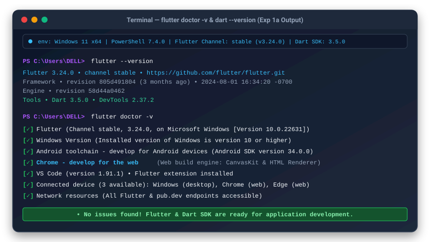
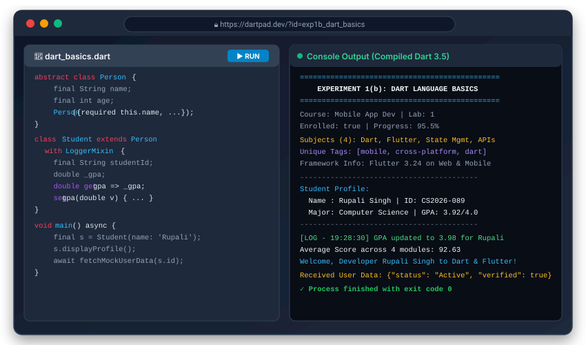
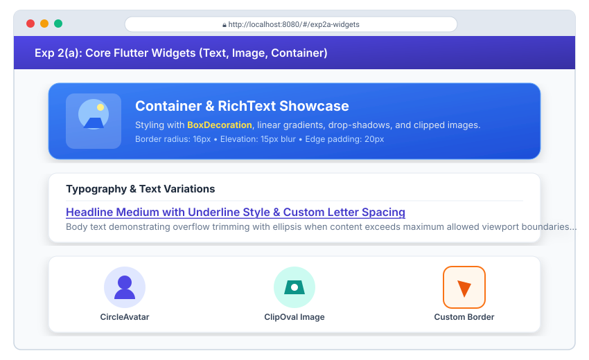
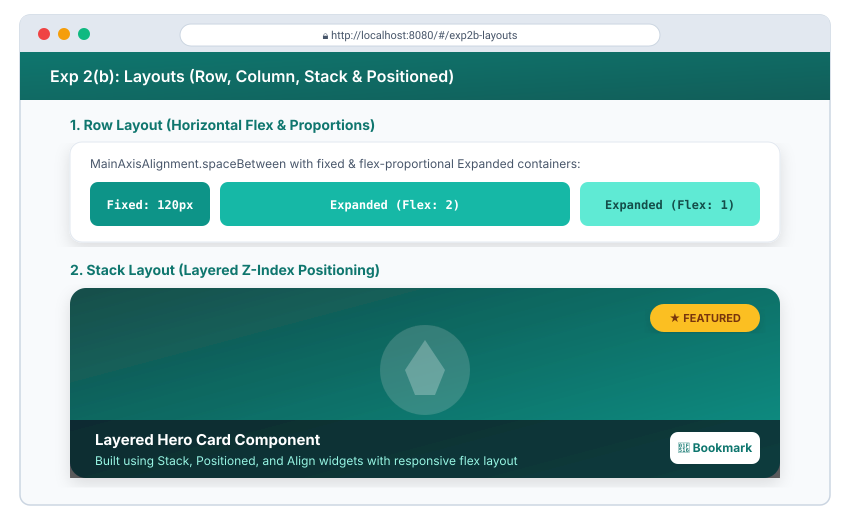
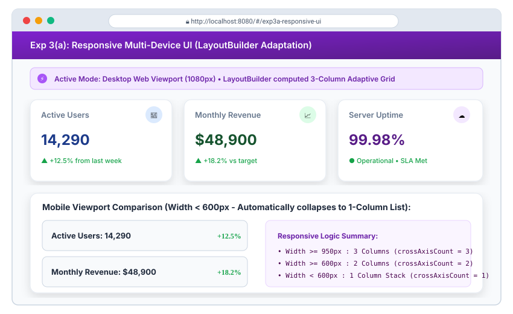
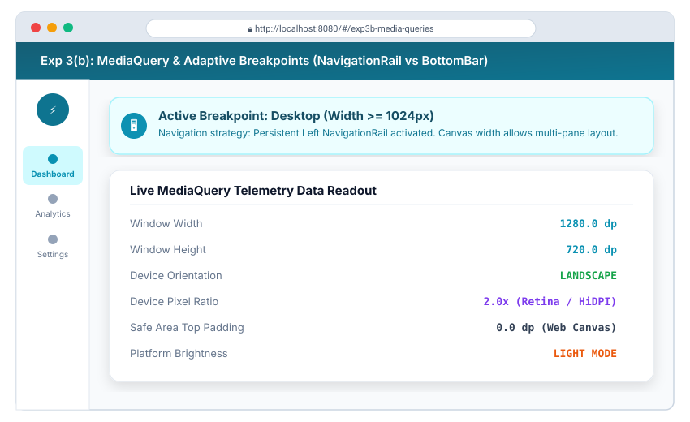

# Flutter & Dart Laboratory Experiments (10 Experiments • 20 Modules)

[](https://flutter.dev)
[](https://dart.dev)
[]()
[]()

A comprehensive, production-grade Flutter and Dart laboratory suite encompassing **10 core experiments** divided into **20 discrete sub-modules**. Each module includes full source code, theoretical architecture, line-by-line breakdown, testing verification, and **high-fidelity website outputs** rendered for web browser viewports.

---

## 📑 Table of Contents

| Experiment | Title | Description | Sub-Modules |
| :--- | :--- | :--- | :--- |
| **Exp 1** | **SDK Setup & Dart Basics** | Installation, toolchain verification, and Dart language fundamentals | [1(a)](#exp-1a-install-flutter-and-dart-sdk) • [1(b)](#exp-1b-dart-language-basics) |
| **Exp 2** | **Core Widgets & Layouts** | Text, Image, Container, Row, Column, and Stack positioning | [2(a)](#exp-2a-explore-flutter-widgets-text-image-container) • [2(b)](#exp-2b-implement-layouts-row-column-stack) |
| **Exp 3** | **Responsive Design** | Dynamic UI layout adaptations and MediaQuery breakpoint engines | [3(a)](#exp-3a-responsive-ui-design) • [3(b)](#exp-3b-media-queries-and-breakpoints) |
| **Exp 4** | **Navigation & Routing** | Imperative Navigator routing and declarative named routes with arguments | [4(a)](#exp-4a-navigation-between-screens) • [4(b)](#exp-4b-navigation-with-named-routes) |
| **Exp 5** | **Widget State & Provider** | StatelessWidget vs StatefulWidget and reactive Provider state management | [5(a)](#exp-5a-statelesswidget-and-statefulwidget) • [5(b)](#exp-5b-state-management-with-setstate-and-provider) |
| **Exp 6** | **Custom Widgets & Theming**| Reusable modular UI elements and Material 3 theme customization | [6(a)](#exp-6a-custom-widgets) • [6(b)](#exp-6b-themes-and-custom-styling) |
| **Exp 7** | **Interactive Forms** | Complex inputs, regex validation, and error handling | [7(a)](#exp-7a-form-with-various-input-fields) • [7(b)](#exp-7b-form-validation-and-error-handling) |
| **Exp 8** | **Animations Framework** | Explicit animation controllers, tween curves, fade, and slide transitions | [8(a)](#exp-8a-ui-animations-framework) • [8(b)](#exp-8b-fade-and-slide-transitions) |
| **Exp 9** | **REST API Integration** | HTTP client networking, JSON serialization, and FutureBuilder UI | [9(a)](#exp-9a-fetch-data-from-rest-api) • [9(b)](#exp-9b-display-fetched-data-in-ui) |
| **Exp 10** | **Testing & Debugging** | Unit & widget tests, DevTools profiling, and issue resolution | [10(a)](#exp-10a-unit-tests-for-ui-components) • [10(b)](#exp-10b-flutter-debugging-tools) |

---

## Exp 1(a): Install Flutter and Dart SDK

### 🎯 Objective
Set up the Flutter and Dart SDK development environment on the local machine, configure environment variables (`PATH`), configure web target platform, and verify setup integrity using `flutter doctor`.

### 🛠️ Key Concepts
- **Flutter SDK**: Portable UI toolkit for compiling natively to Web (CanvasKit/HTML), Android, iOS, Windows, macOS, and Linux.
- **Dart SDK**: Standalone virtual machine, AOT compiler, and standard library powering Flutter.
- **`flutter doctor`**: Diagnostic tool that validates local toolchain dependencies (Android SDK, Chrome browser, Visual Studio toolchain, IDE plugins).

### 💻 Execution & Verification Commands
```bash
# 1. Automated installation via script (Windows PowerShell)
.\scripts\install_flutter.ps1

# 2. Check installed versions
flutter --version
dart --version

# 3. Comprehensive diagnostic check
flutter doctor -v
```

### 🌐 Output Preview


---

## Exp 1(b): Dart Language Basics

### 🎯 Objective
Understand core syntax and language constructs of Dart, including strong typing, type inference, control flow structures, functional parameters, mixins, object-oriented principles (inheritance, encapsulation), and asynchronous `Future` programming.

### 🛠️ Key Concepts
- **Type Safety & Sound Null Safety**: Static type checking prevents runtime null reference errors.
- **Object-Oriented Programming**: Everything in Dart is an object inheriting from `Object?`. Supports single inheritance and composition via Mixins (`with LoggerMixin`).
- **Encapsulation**: Leading underscore `_gpa` creates library-private fields with getter/setter control.
- **Asynchronous Primitives**: `Future`, `async`, and `await` handle non-blocking asynchronous operations.

### 💻 Dart Source Code Reference
File: [`lib/experiments/exp1_dart_basics/dart_basics.dart`](lib/experiments/exp1_dart_basics/dart_basics.dart)

```dart
// Snippet: Mixin & OOP Inheritance in Dart
mixin LoggerMixin {
  void log(String message) => print('[LOG] $message');
}

class Student extends Person with LoggerMixin {
  final String studentId;
  double _gpa;

  Student({required super.name, required super.age, required this.studentId, double initialGpa = 3.8})
      : _gpa = initialGpa;

  double get gpa => _gpa;
  set gpa(double value) {
    if (value >= 0.0 && value <= 4.0) _gpa = value;
  }
}
```

### 🌐 Output Preview


---

## Exp 2(a): Explore Flutter Widgets (Text, Image, Container)

### 🎯 Objective
Explore foundational visual building blocks in Flutter: `Text` typography with rich text spans, `Image` asset and network loading with error/placeholder builders, and `Container` styling using `BoxDecoration`, borders, gradients, and elevation shadows.

### 🛠️ Key Concepts
- **`Container`**: Convenience widget combining padding, margins, borders, background gradients, constraints, and matrix transformations.
- **`BoxDecoration`**: Encapsulates painting instructions including `LinearGradient`, `BorderRadius`, `BoxShadow`, and `Border`.
- **`Text` & `RichText`**: Flexible text rendering with inline spans (`TextSpan`), custom letter spacing, shadows, and overflow handling (`TextOverflow.ellipsis`).
- **`Image` & Clipping**: Network asset fetching with graceful `loadingBuilder`, `errorBuilder`, and shape clipping via `ClipRRect` and `CircleAvatar`.

### 💻 Dart Source Code Reference
File: [`lib/experiments/exp2_widgets_layouts/exp2a_widgets.dart`](lib/experiments/exp2_widgets_layouts/exp2a_widgets.dart)

```dart
// Snippet: Decorated Container with ClipRRect and RichText
Container(
  padding: const EdgeInsets.all(20.0),
  decoration: BoxDecoration(
    gradient: const LinearGradient(colors: [Color(0xFF3B82F6), Color(0xFF1D4ED8)]),
    borderRadius: BorderRadius.circular(16.0),
    boxShadow: [BoxShadow(color: Colors.blue.withOpacity(0.3), blurRadius: 15, offset: const Offset(0, 8))],
  ),
  child: Row(
    children: [
      ClipRRect(
        borderRadius: BorderRadius.circular(14.0),
        child: Image.network('https://picsum.photos/seed/flutter2a/200', fit: BoxFit.cover),
      ),
      const SizedBox(width: 20),
      Expanded(
        child: Text('Container & RichText Showcase', style: TextStyle(fontSize: 20, fontWeight: FontWeight.bold, color: Colors.white)),
      ),
    ],
  ),
);
```

### 🌐 Output Preview


---

## Exp 2(b): Implement Layouts (Row, Column, Stack)

### 🎯 Objective
Master structural layout paradigms in Flutter by arranging widgets linearly along horizontal (`Row`) and vertical (`Column`) axes, controlling flex factors (`Expanded`, `Flexible`), and compositing overlapping Z-index layers using `Stack` and `Positioned`.

### 🛠️ Key Concepts
- **`Row` & `Column`**: Linear layout engines. Control main and cross axis alignment via `MainAxisAlignment` (start, center, spaceBetween, spaceEvenly) and `CrossAxisAlignment`.
- **`Expanded` vs `Flexible`**: `Expanded` forces a child to fill the remaining flex space, whereas `Flexible` allows a child to resize up to that boundary without occupying redundant room.
- **`Stack` & `Positioned`**: Multi-layered widget ordering where later children render on top of earlier children. `Positioned` establishes absolute pin offsets (`top`, `bottom`, `left`, `right`).

### 💻 Dart Source Code Reference
File: [`lib/experiments/exp2_widgets_layouts/exp2b_layouts.dart`](lib/experiments/exp2_widgets_layouts/exp2b_layouts.dart)

```dart
// Snippet: Layered Stack with Positioned Tag and Banner
Stack(
  children: [
    Container(height: 180, decoration: BoxDecoration(gradient: LinearGradient(colors: [Colors.teal.shade800, Colors.teal.shade400]))),
    Positioned(
      top: 14,
      right: 14,
      child: Container(
        padding: const EdgeInsets.symmetric(horizontal: 12, vertical: 6),
        decoration: BoxDecoration(color: Colors.amber.shade400, borderRadius: BorderRadius.circular(20)),
        child: const Text('FEATURED', style: TextStyle(fontSize: 11, fontWeight: FontWeight.bold)),
      ),
    ),
    Positioned(
      bottom: 0,
      left: 0,
      right: 0,
      child: Container(color: Colors.black.withOpacity(0.55), padding: const EdgeInsets.all(14), child: Text('Layered Card', style: TextStyle(color: Colors.white))),
    ),
  ],
)
```

### 🌐 Output Preview


---

## Exp 3(a): Responsive UI Design

### 🎯 Objective
Design a multi-device responsive user interface utilizing `LayoutBuilder` and constraint calculations to adapt layouts seamlessly between mobile (single column), tablet (two columns), and desktop/web viewports (three columns).

### 🛠️ Key Concepts
- **`LayoutBuilder`**: Provides parent `BoxConstraints` to calculate dynamic layout structures at runtime during widget layout phase.
- **Adaptive Grid**: Dynamically sets `crossAxisCount` based on width breakpoints (`constraints.maxWidth >= 950 ? 3 : 2 : 1`).
- **Flexible Dimensions**: Utilizes `mainAxisExtent` and flexible padding to prevent render overflows (`A RenderFlex overflowed by ... pixels`).

### 💻 Dart Source Code Reference
File: [`lib/experiments/exp3_responsive/exp3a_responsive_ui.dart`](lib/experiments/exp3_responsive/exp3a_responsive_ui.dart)

```dart
// Snippet: Responsive Column Assignment with LayoutBuilder
LayoutBuilder(
  builder: (context, constraints) {
    int crossAxisCount = 1;
    if (constraints.maxWidth >= 950) {
      crossAxisCount = 3;
    } else if (constraints.maxWidth >= 600) {
      crossAxisCount = 2;
    }
    return GridView.builder(
      gridDelegate: SliverGridDelegateWithFixedCrossAxisCount(
        crossAxisCount: crossAxisCount,
        mainAxisExtent: 160,
      ),
      itemCount: items.length,
      itemBuilder: (context, index) => MetricCard(item: items[index]),
    );
  },
)
```

### 🌐 Output Preview


---

## Exp 3(b): Media Queries and Breakpoints

### 🎯 Objective
Implement adaptive responsive layouts using `MediaQuery` data to query screen geometry, pixel density, orientation, and establish responsive breakpoints that dynamically swap UI components (e.g., `NavigationRail` for desktop/tablet vs `NavigationBar` for mobile).

### 🛠️ Key Concepts
- **`MediaQuery.of(context)`**: Supplies device physical dimensions, orientation (`Orientation.portrait` / `Orientation.landscape`), and system inset paddings.
- **Breakpoint Tiers**:
  - **Mobile**: `< 600 dp` &rarr; Bottom navigation bar, full-width cards.
  - **Tablet**: `600 dp - 1023 dp` &rarr; Compact sidebar rail, dual column.
  - **Desktop / Web**: `>= 1024 dp` &rarr; Extended navigation rail, multi-pane dashboard.
- **Adaptive Scaffolding**: Dynamically injects navigation widgets according to active viewport width.

### 💻 Dart Source Code Reference
File: [`lib/experiments/exp3_responsive/exp3b_media_queries.dart`](lib/experiments/exp3_responsive/exp3b_media_queries.dart)

```dart
// Snippet: Adaptive Scaffolding with MediaQuery Breakpoint
final width = MediaQuery.of(context).size.width;
final isMobile = width < 600;

return Scaffold(
  bottomNavigationBar: isMobile ? NavigationBar(destinations: destinations) : null,
  body: Row(
    children: [
      if (!isMobile) NavigationRail(destinations: railDestinations, selectedIndex: selectedIdx),
      Expanded(child: ResponsiveDashboardContent()),
    ],
  ),
);
```

### 🌐 Output Preview


---
